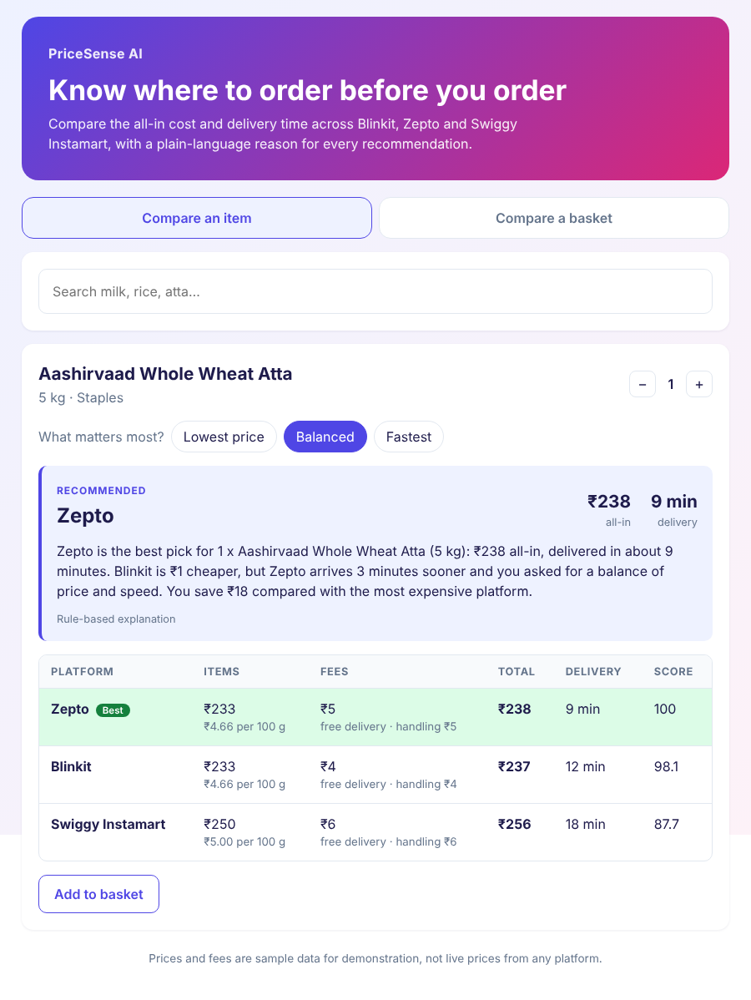

# PriceSense AI

PriceSense AI compares the all-in cost of groceries across quick-commerce platforms (Blinkit, Zepto, Swiggy Instamart) and recommends where to order, with a plain-language reason. It was built for Microsoft Imagine Cup 2026.



> **Demo data.** The prices and fee rules in this repo are generated sample data, not live prices from any platform. See [Data](#data).

## What it does

- **Compares the real total, not the sticker price.** Each platform's delivery fee, handling fee, small-cart fee and free-delivery threshold are applied before ranking.
- **Ranks by what you care about.** Choose lowest price, fastest delivery, or a balance that puts a rupee value on waiting time.
- **Explains every recommendation.** The explanation names the trade-off, for example when another platform is cheaper but slower.
- **Compares whole baskets.** Shows which platforms can fulfil the full basket, which items are missing elsewhere, and whether splitting the order across platforms saves money.
- **Finds products from loose input.** Search handles brand names, Hindi aliases (`doodh`, `chawal`) and typos (`mlik`).

## How the recommendation works

The scoring engine in [`ai/scoring.py`](ai/scoring.py) is deterministic. For each platform it builds a quote (items + fees) and then ranks by an effective cost:

| Priority | Effective cost |
| --- | --- |
| Lowest price | all-in total |
| Fastest | delivery time |
| Balanced | all-in total + ₹2 for every minute of delivery time |

The best option scores 100 and the others score in proportion.

Explanations come from [`ai/explanation.py`](ai/explanation.py). By default they are built from the computed numbers. If you set `GEMINI_API_KEY`, Gemini rewrites the explanation in more natural language. The model never picks the platform: it only receives the engine's result, and its answer is discarded in favour of the built-in explanation if the request fails or the text does not mention the recommended platform.

More detail: [architecture](docs/architecture.md) · [problem statement](docs/problem.md) · [responsible AI notes](docs/responsible-ai.md)

## Run it locally

You need Python 3.10+ and Node 18+.

**Backend** (from the repo root):

```bash
python -m venv .venv
source .venv/bin/activate        # Windows: .venv\Scripts\activate
pip install -r backend/requirements.txt
uvicorn backend.main:app --reload --port 8000
```

Interactive API docs are at http://localhost:8000/docs.

**Frontend** (in a second terminal):

```bash
cd frontend
npm install
npm run dev
```

Open http://localhost:3000.

**Optional: LLM explanations.** Copy `.env.example` to `.env` and set `GEMINI_API_KEY`. Never commit `.env`.

## API

| Method | Path | Purpose |
| --- | --- | --- |
| GET | `/products?q=&category=&limit=` | Search the catalog |
| GET | `/products/{id}` | One product with its offer on each platform |
| GET | `/categories` | Category names |
| GET | `/platforms` | Platforms and their fee rules |
| GET | `/compare?product_id=` or `?item=` | Rank platforms for one product. Also takes `qty`, `priority`, `explain` |
| POST | `/basket` | Rank platforms for a basket and look for a cheaper split order |
| GET | `/health` | Status, and whether LLM explanations are enabled |

Example:

```bash
curl "http://localhost:8000/compare?item=butter&priority=balanced"
```

## Tests

```bash
pip install -r requirements-dev.txt
pytest
```

The tests cover the fee rules, ranking, split-order logic, search, every endpoint, and the LLM fallback paths (with the network call mocked).

## Data

`backend/data/catalog.json` holds 42 products and is generated by [`scripts/build_catalog.py`](scripts/build_catalog.py) from a rough MRP per item plus a seeded random discount per platform. `backend/data/platforms.json` holds illustrative fee rules. Neither reflects what any platform actually charges.

These platforms do not offer public price APIs, so a production version would need a licensed data source or a partnership. The catalog loader in `backend/catalog.py` is the only place that would change.

## Project structure

```
ai/         scoring engine and explanation writer (no web framework code)
backend/    FastAPI app, routes, catalog loader, sample data
frontend/   React + Vite single-page app
scripts/    sample-data generator
tests/      pytest suite
docs/       problem statement, architecture, responsible AI notes
```

## Limitations

- Sample data only; no live prices, stock or delivery estimates.
- Delivery time is one fixed number per platform, not location- or time-aware.
- The split-order search is a heuristic and can miss a cheaper split in some edge cases (see the docstring on `best_split`).
- No accounts, order placement or price history.
