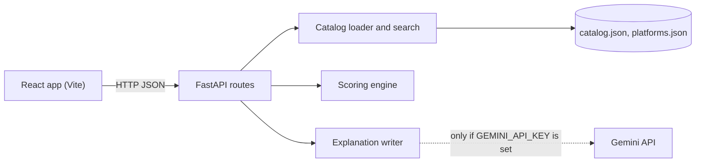

# Architecture

## Layers

**`ai/scoring.py`** is the core. It has no I/O and no framework imports. Given products, quantities and platform fee rules it returns quotes, a ranking and a summary of the trade-offs. Because it is pure, the same input always produces the same output and it is covered by fast unit tests.

**`ai/explanation.py`** turns the summary into text. The template writer is always available. The Gemini writer is optional and guarded: it is sent only the computed facts, has an 8-second timeout, and its output is rejected unless it mentions the platform the engine chose. Any failure falls back to the template, so the API response shape never changes.

**`backend/catalog.py`** loads the JSON data once and provides search. Search scores exact, prefix and substring matches on name, brand and aliases, then falls back to fuzzy matching for typos. Swapping in a real data source means replacing this module.

**`backend/routes/`** validates input with FastAPI and Pydantic (bounded string lengths, quantities from 1 to 20, at most 30 basket lines) and maps engine results to JSON.

**`frontend/`** is a small React app with two views that share one basket and one priority setting. `src/utils/api.js` is the only file that knows the API URL.

## Request flow for `/compare`

1. Resolve the product from `product_id`, or the best search match for `item`.
2. Build a quote for each platform: line total, then fees based on the cart subtotal.
3. Drop platforms that do not have the item, and list them as unavailable.
4. Rank the remaining quotes by effective cost for the chosen priority.
5. Summarise: recommended, cheapest, fastest, and the differences between them.
6. Write the explanation and return everything, including the full fee breakdown.

## Basket and split orders

`/basket` quotes the whole basket on each platform and ranks only the platforms that can supply every item. It then checks each group of two or more platforms: every item goes to whichever platform in the group sells it cheapest, fees are added per platform, and the cheapest result is kept. A split is suggested only if it saves at least ₹10 over the best single platform, or if no single platform has everything.

This is a heuristic. It does not consider moving an item to a slightly pricier platform to tip that cart over a free-delivery threshold, so it can miss the true optimum.

## Design choices

- **Effective cost instead of weighted normalised scores.** An earlier version min-max normalised price and time and mixed them with weights. With only two or three options that treats a ₹1 difference the same as a ₹100 one. Pricing a minute of waiting in rupees keeps the size of the difference in the decision and is easy to explain.
- **The LLM explains; it does not decide.** Recommendations involve money, so the choice must be reproducible and testable.
- **Integer rupees.** All prices and fees are whole rupees, which avoids floating-point drift in totals.
